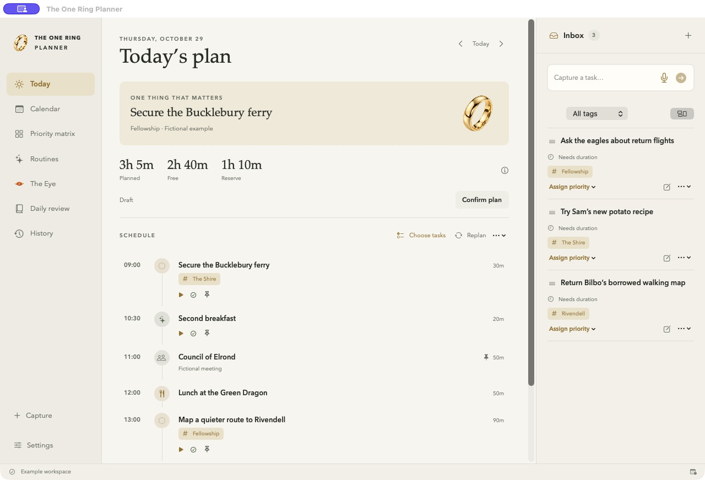
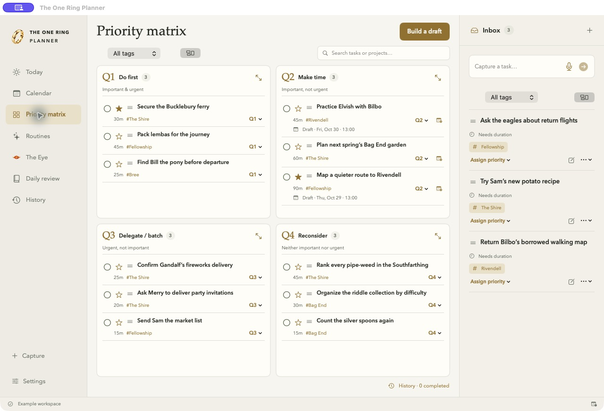
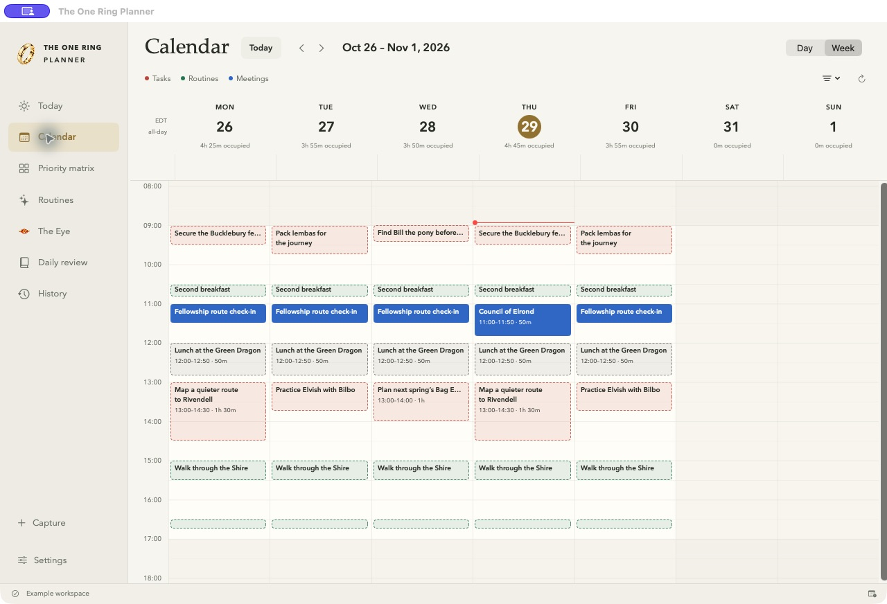
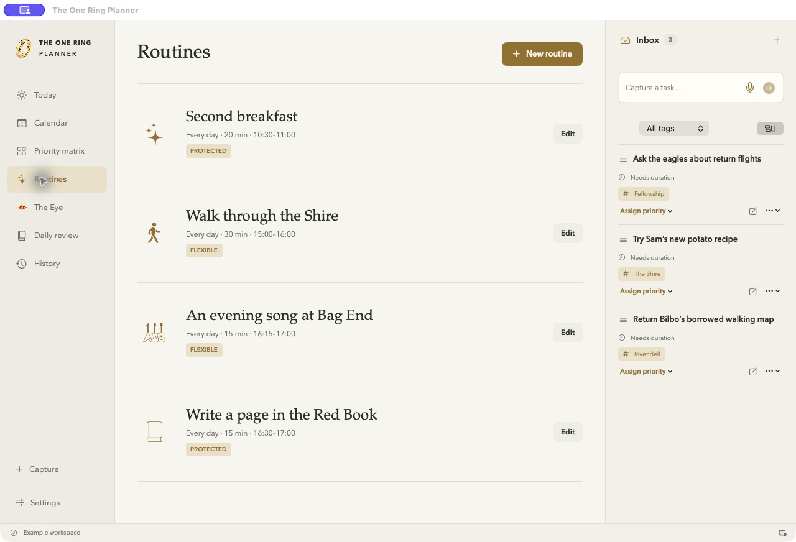
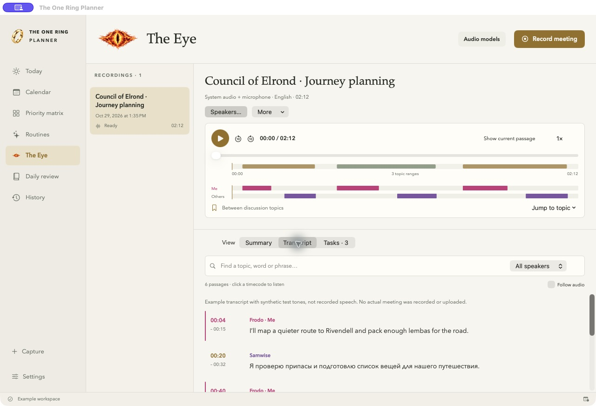

# The One Ring Planner

**A little less chaos. A little more second breakfast.**

A native macOS planner that brings tasks, routines, Google Calendar and meeting notes into one quiet workspace. Built with Swift, SwiftUI and AppKit, plus a small Objective-C audio bridge, with no third-party package dependencies.

**Current version:** 0.28.2 · Personal desktop application · macOS 14+



All screenshots use an isolated, fictional Middle-earth workspace. No personal tasks, calendars, credentials or real meeting recordings are shown.

## What it does

- **Capture and arrange:** a shared Inbox for text, links and multiple images, advisory AI Task/Note suggestions, searchable tags, and a four-quadrant matrix. Drag tasks between quadrants, change priorities, or expand a quadrant to focus.
- **Plan a realistic day:** work hours, lunch, meetings, routines, transitions, focus blocks and reserve all count toward capacity. Daily review prepares the next working day, skipping weekends: Friday plans target Monday. Choose its tasks before confirming the plan.
- **Find time in Google Calendar:** Q2 suggests an available slot; accept it or choose another on the calendar. Drag or resize scheduled tasks and routines, with changes synced to Google. Tasks are red; routines are green.
- **Build routines:** daily, weekdays, weekends or selected days, with flexible/protected placement and small completion celebrations.
- **Record with The Eye:** system audio, microphone or both; English/Russian transcription, speaker aliases, topics, timecodes and reviewed task extraction. Your “Me” speaker lane stays pink.
- **Keep the history:** complete a task from any quadrant, inspect past work, restore tasks, and re-transcribe meetings with another model while retaining older transcript versions.
- **Stay nearby:** a colored ring in the menu bar, recording controls, global capture shortcuts and optional alerts one minute before events.

In **Today**, click a task’s circle to complete the whole task. Completed tasks appear below the schedule, with an option to mark them incomplete and return them to their priority quadrant. **Task actions → Move to backlog** removes unfinished work from saved schedules while keeping its priority, estimate and details. Completion shows a brief gold check animation with Undo and a soft chime; turn the sound off in **Settings → Completion**. Reduce Motion is respected, and the chime stays quiet during meeting or Inbox recording. Published Google changes still require plan confirmation.

**New in 0.26.0: [Shared Inbox](docs/library/shared-inbox.md).** Capture first, then drag into a quadrant to create a task or into Library to create a note. AI suggests the type and tags; your destination wins. Links are clickable and copy controls use small icons.

**Also included:** Shire-inspired parchment and green navigation, multi-image clipboard capture for tasks and notes, and automatic AI categorization. Task microphone recording and its shortcut are removed; meeting recording stays in The Eye.

**[Personal Library](docs/library/README.md).** Save images, prompts, Markdown, skills and URLs without creating tasks. Capture has independent Task / Note drafts. Library includes a gallery/list, exact copying, editing, recoverable Trash, local OCR/keyword search, automatic AI organization and verified embedding search, private GitHub backup and isolated restore. An optional [Telegram inbox service](services/telegram-inbox/README.md) receives references while the Mac sleeps. External services require explicit setup; the demo stays local.

## A quick tour

### Decide what matters

Inbox stays on the right. Drag a task to a quadrant; if duration or other required details are missing, the planner asks before moving it. Each quadrant scrolls independently and can expand to full screen.



### See where the day goes

The day/week calendar draws each block in proportion to its duration. Move a task or routine to another time or day, or drag its edges to change its length. Confirmed Google bookings keep the same event identity through edits.



### Let the little things repeat

Create routines, pick repeat days, and give them a suitable window. Editing one scheduled calendar occurrence leaves the repeating template intact.



### Turn a conversation into next steps

The Eye combines playback, a topic timeline, searchable timestamped text and task suggestions. Name speakers, mark yourself as “Me”, and review tasks in **Mine → Unassigned → Others** order before adding them to Inbox.



Use **More → Re-transcribe…** to choose another audio model or rerun the same one. The current result stays available while the new attempt runs. **More → Transcript versions…** restores an earlier result; imported tasks and original audio remain intact. Interrupted processing can resume from saved checkpoints.

## Build and deploy on your Mac

This repository contains source code. There is no web server, database service or hosted backend to deploy; Google Calendar and a LiteLLM gateway are optional connections.

### Requirements

| Requirement | Notes |
| --- | --- |
| Mac | macOS 14 or later; developed and tested on Apple silicon |
| Build tools | Swift toolchain with the macOS 26 SDK, from recent Xcode or Command Line Tools; verified with Swift 6.3.3 |
| Utilities | Git, Python 3, and the macOS tools `codesign`, `security`, `sips`, `iconutil`, `ditto` and `openssl` |
| Optional services | Your own Google Cloud Desktop OAuth client; a LiteLLM-compatible gateway and key for cloud AI |

System audio capture requires macOS 14.2+. Apple’s newer local transcription path requires macOS 26 and installed language assets. Other meeting transcription can use the configured gateway.

### 1. Get the source

```sh
git clone https://github.com/nbnm/the-one-ring-planner.git
cd the-one-ring-planner
```

If build tools are missing, install Command Line Tools with `xcode-select --install`. Check `swift --version` and `xcrun --show-sdk-path` before building. Python 3 must be available as `python3`.

### 2. Check and build

```sh
./scripts/test.sh
./scripts/build-app.sh
```

The application is created at **`build/The One Ring Planner.app`**. The build script creates or reuses a dedicated local signing identity in your login Keychain. macOS may ask you to authorize its creation/use. No API key, Google account or Apple Developer subscription is needed for a local build.

### 3. Install and launch

Save any recording, wait for processing to finish, then quit any running copy with **Command + Q** or **Quit** in the ring menu. Closing the window leaves the app running in the menu bar.

```sh
./scripts/build-app.sh --install
```

This builds, copies the app to **`~/Applications/The One Ring Planner.app`**, and opens it. Installation refuses to replace a running planner. For a copy you already built, you can instead use:

```sh
mkdir -p "$HOME/Applications"
ditto "build/The One Ring Planner.app" "$HOME/Applications/The One Ring Planner.app"
open "$HOME/Applications/The One Ring Planner.app"
```

A normal first launch has an empty Inbox. Set your planning time zone, workday and routine preferences in Settings. Allow microphone, system audio or notifications only when using the related features; the app explains failures and preserves existing recordings.

### 4. Preview with fictional data

Quit the regular app first to avoid overlapping menu bar items and shortcuts, then run:

```sh
open -n "build/The One Ring Planner.app" --args --demo --middle-earth-demo
```

This is the same fixture used for the screenshots: tasks about Hobbits and the Fellowship, Shire routines, and a bilingual example meeting with synthetic test tones. It uses temporary task/meeting folders, separate connection preferences and separate Keychain service names. It does not read your normal task or meeting workspace or connect your real Google calendar. Demo recording creates test tones instead of capturing a call. Quit and launch normally to return to your own workspace.

### 5. Update an existing installation

```sh
git switch main
git pull --ff-only
./scripts/test.sh
./scripts/build-app.sh
```

Quit the installed planner, then install using step 3. Keep the existing local signing identity across builds. macOS may still request Keychain authorization after an update; a stable local signature does not guarantee prompt-free access.

### Distribution to other people

The build script produces a **locally signed personal app**, not a Developer ID signed/notarized distribution. Other Macs should build their own copy using these instructions. Public binary distribution needs a separate Developer ID signing/notarization workflow and an appropriately configured Google OAuth project; neither is automated here. The build targets the current Mac’s architecture.

## Connect Google Calendar

The integration talks directly to Google; it does not use macOS Calendar or EventKit.

1. Create/select your Google Cloud project and [enable the Calendar API](https://console.cloud.google.com/apis/library/calendar-json.googleapis.com).
2. Configure Google Auth Platform’s branding, audience and contact details. Use an eligible Workspace **Internal** audience, or **External** with your account as a test user while testing.
3. Create an OAuth client of type **Desktop app** and download its JSON. An API key or web client is insufficient. See [Google’s Desktop OAuth guide](https://developers.google.com/identity/protocols/oauth2/native-app).
4. In **Settings → Google Calendar**, choose **Import OAuth credentials…**, then **Sign in with Google**. Complete consent in your browser and select the calendars that should affect availability.
5. For bookings, choose **Enable calendar writing**, approve the additional permission, and select a destination calendar you own.
6. Use **Confirm & add to calendar** for a day plan, or accept an individual Q2 time slot. Merely browsing or saving a draft does not publish it.

The app initially requests `calendar.calendarlist.readonly` and `calendar.events.readonly`; writing adds `calendar.events.owned`. See [Google’s scope definitions](https://developers.google.com/workspace/calendar/api/auth). Tokens and imported credentials are held in Keychain. External apps in Testing can require sign-in again after seven days because of [Google’s refresh-token rules](https://developers.google.com/identity/protocols/oauth2#expiration).

Google time changes are read on activation, manual refresh and every five minutes while the app runs. Calendar edits are queued locally and retried after failure. Concurrent edits require choosing **Use Google time** or **Apply my time**. External title/notes/deletion synchronization is not implemented as a general two-way import.

## Connect LiteLLM and meeting AI

1. Open **Settings → Task cleanup · LiteLLM**.
2. Enter your gateway base URL (for example, `https://your-gateway.example/v1`), its text-model alias, and your key. Save and test the connection. No key belongs in this repository or an `.env` file.
3. In **The Eye → Audio models**, check the gateway catalog and choose a separate audio transcription alias. The gateway must expose `/audio/transcriptions`; the text alias must support `/chat/completions`.
4. Use a diarization-capable model for individual speaker labels. `whisper-1` uses timestamped transcription without individual speaker separation. Catalog names alone do not prove the gateway supports a feature.
5. Choose processing explicitly and review the gateway/model information before uploading. Review extracted tasks before adding them to Inbox.

Meeting audio stays local until cloud processing is chosen. That sends audio to the saved gateway, followed by transcript analysis through its text model. Text-only analysis sends the saved transcript without audio. Task cleanup sends the capture, tag names and attached image thumbnails to the saved model. Choose a vision-capable task alias for image interpretation. Retention and model routing depend on your gateway.

Long meetings are processed in short audio chunks with bounded retries and saved checkpoints. An hour of synthetic audio is covered by local tests; recognition quality and live processing speed depend on the chosen model, gateway and recording. Speaker aliases are per meeting and explicitly assigned.

## Everyday controls

| Action | Control |
| --- | --- |
| Quick capture | **Control + Option + Space** |
| Save Inbox capture / confirm explicit task review | **Command + Return** |
| Record a meeting | Ring menu → **Record meeting…**, or The Eye |
| Stop/save a meeting | Ring menu or recording-only Eye menu |
| Return from expanded quadrant | **Escape** / **Back to matrix** |
| Quit | **Command + Q** / ring menu → **Quit** |

The Eye appears in the macOS menu bar only during recording/saving. Enable optional event alerts in Settings; macOS notification settings and Focus still apply. Automatic launch at login is not implemented.

## Your data and backups

Application data is separate from this source-code repository:

```text
~/Library/Application Support/The One Ring Planner/
├── Data/       # task, capture, routine, plan and completion JSON; local Git history
├── Local/      # workspace identity and recovery state
├── Meetings/   # original audio, transcripts, versions and processing checkpoints
└── Signing/    # public certificate metadata; private signing key is in Keychain
```

Back up this folder while the app is quit, including the hidden `Data/.git` directory. The local data Git history is not automatically pushed to this GitHub repository. Task deletion does not erase older local Git history. Recordings use recoverable macOS Trash when removed through the app.

Keys and Google tokens stay in macOS Keychain and are not part of a file backup. On a new Mac, reconnect the services and create a local signing identity, or deliberately migrate the existing signing identity and its metadata. Do not replace a saved identity with a different certificate while retaining its old metadata.

## Development and verification

```sh
./scripts/test.sh                   # 200 deterministic core checks
./scripts/test-voice.sh             # legacy voice regression fixture (not part of the app)
./scripts/test-meetings.sh          # 45 generated-audio/playback/capture checks
./scripts/test-audio-input.sh       # 11 native-format, route-recovery and exception-safety checks
./scripts/test-telegram-audio.sh    # 8 generated Ogg/Opus chunking checks; FFmpeg required
./scripts/test-library.sh           # 16 clipboard/media/OCR + 9 mocked hosted-inbox checks; Node 22.13+
swift build                        # compile the native app
```

Optional `./scripts/test-speech-integration.sh` and `./scripts/test-meetings.sh --speech` use generated speech with Apple’s installed language assets; they may download assets and require supported macOS versions. `python3 scripts/test-signing.py` tests the local signing identity against synthetic Keychain items. These are separate from the offline core checks.

| Folder | Purpose |
| --- | --- |
| `Sources/RingCore` | Scheduling, models, persistence, Google API and AI contracts |
| `Sources/RingPlanner` | Native UI, capture, playback, app/menu bar lifecycle |
| `Sources/RingAudioSupport` | Hardware microphone format and native audio exception handling |
| `Tests` | Dependency-free checks and generated audio fixtures |
| `scripts` | App packaging, local signing and verification |
| `docs` | Screenshots, implementation notes and detailed feature reference |

See [the feature reference](docs/feature-reference.md) and [implementation notes](docs/implementation.md) for detailed behavior and limitations. Artwork is AI-generated, with prompts retained under `docs/artwork`. This is an unofficial fan-inspired project and is not affiliated with the creators or owners of The Lord of the Rings.

### Work and Personal tasks

Captures use the saved LiteLLM connection to suggest exactly one **Work** or **Personal** tag, alongside project/topic tags. Each task in a mixed capture is classified independently. Change the category in task details or capture review; use the tag filter to show either category in the same inventory and priority matrix. Existing unclassified tasks retain their previous work scheduling behavior; they are not bulk-sent to AI.

Personal tasks use the **Personal time** windows in Settings (default: weekdays 18:00–21:00, weekends 10:00–20:00). Day planning and Q2 suggestions check real calendar commitments in those windows. Personal tasks can be planned on weekends; explicit Work tasks stay on working days in automatic day plans. Manual calendar choices remain available. Accepted events use the existing Google Calendar destination and sync flow. A failed AI call preserves the saved item for manual correction.

### Library folders

Use the folder menu in Library to create folders or nested paths such as `Shire/Recipes`, rename folders, or reveal them in Finder. Move a note with its folder selector or **Move to folder** menu. New notes use the selected folder. All folders and Unfiled views remain available, and search respects the selected folder and its descendants.

Folders are real directories under the data workspace’s `Data/notes/` directory. Notes remain lossless JSON records named by their stable IDs, for example `Data/notes/Shire/Recipes/<note-id>.json`; attachments remain in the shared content-addressed `note-assets/` directory. Folder moves retain note IDs, original captures, attachments and Git history. Empty folders are recorded in `settings/library-folders.json` and recreated on restore. Private Git backups and independent archives include nested folders. Organize and rename through the app; direct filesystem moves are not imported automatically.

### Automatic private GitHub backup

Settings → Data & backup supports **GitHub CLI · existing login**, as well as a token saved in Keychain. With GitHub CLI installed (`brew install gh`), sign in once using `gh auth login` and select that method when enabling a private data remote. The app reuses that login in memory without copying its token into another credential store. Logging out of GitHub CLI pauses uploads; local saves continue.

Backup sends the data repository and its existing Git history: active and completed tasks, completion snapshots, original captures, plans, routines, notes and their folders, and attached images. Meeting audio, OAuth/LLM credentials, local connection settings and signing keys are outside that repository. Every task or note save schedules a backup after a short idle period. Startup and a periodic check also retry outstanding changes. The app checks that the destination is private before each push and verifies the remote commit afterward. Concurrent remote changes pause backup instead of force-pushing. See **Last verified remote backup** in Settings for the last confirmed upload.

### Private Telegram bot · direct polling

1. Create a dedicated bot with Telegram’s **@BotFather**, or use your existing bot. In the planner, open **Settings → Telegram → Connection**, paste its token, and choose **Connect bot**. The token is stored in macOS Keychain. If that bot has an existing webhook, the app asks you to replace it; pending updates are retained.
2. Send the displayed `/pair …` command to the bot in your **private** Telegram chat within ten minutes. Pairing binds the bot to your numeric sender/chat ID. Group messages, other senders and unpaired commands are ignored and never imported or answered. A bot username can still be discovered on Telegram; access to planner data is restricted to the paired owner.
3. Set **Poll every … seconds** (5–300; default 15) and save preferences. Polling runs in the Mac app with its window closed, while the Mac is awake and the app is running. Telegram retains updates for up to 24 hours; leave the app running regularly. No webhook or hosted service is needed for this mode.

Text, links, photos, captions, documents, audio and other media messages become shared Inbox captures. Each Telegram message keeps its own capture identity; duplicate deliveries/restarts do not create duplicate Inbox items. Files up to 20 MB are supported by Telegram's standard download API and the app's attachment limit. Unrecognized document types are retained as binary attachments with their original names. Attachments can be revealed in Finder from the Inbox reader. Unsupported message kinds are captured as message metadata rather than executed.

Voice/audio notes preserve their original audio with the Inbox capture and use the configured transcription alias, falling back to **The Eye** audio model. Install FFmpeg (`brew install ffmpeg`) for Telegram Ogg/Opus and other audio formats. Audio up to two hours is converted to bounded three-minute AAC chunks. Successful chunk transcripts are checkpointed; network/model failures keep the capture and can be retried in Telegram settings or from Inbox. Automatic language detection supports Russian/English when the selected model supports them. Independent task suggestions can be split into multiple Inbox items; the original audio and full transcript remain in the archived source capture. Suggestions never enter quadrants or calendars until you place them yourself. Switching the transcription alias before retrying invalidates partial text from the previous model.

Commands: `/help`, `/today`, `/tomorrow`, `/next`, `/tasks [page]`, `/work [page]`, `/personal [page]`, `/task ID`, `/find words`, `/inbox [page]`, `/status`. Queries use the current day in the planner's time zone, independently of the date open in the app. Task commands are read-only; plan replies identify drafts. New commands can be answered while an audio job is processing.

Daily plan digests, Q1 task notifications and event alerts are opt-in in **Digests & alerts**. Daily digests send once after the selected local time while the app is running. Event alerts require polling every 30 seconds or faster and are checked approximately one minute before confirmed events. Expired alerts are dropped. Confirmed sends are tracked across restarts. Telegram has no sendMessage idempotency key: an unconfirmed send is paused for review rather than automatically duplicated; **Retry unconfirmed sends** explains that a duplicate is possible. Rate-limited sends retry after Telegram's requested delay.

The bot token, paired chat ID, polling cursor and pending processing/delivery queue stay in the workspace's local state/Keychain, outside Git backup. Imported Inbox captures, original audio/files and derived transcripts are included in the existing private data backup. The earlier hosted Library-inbox implementation remains available in source for compatibility; its automatic poll loop is disabled in favor of the direct shared-Inbox integration.

### Telegram appearance

**Settings → Telegram → Appearance → Update bot profile** applies the app's gold ring on a pine-green avatar, the display name **The One Ring Planner**, and English/Russian profile descriptions. The existing bot username and owner pairing are preserved. Telegram confirms the name, About text and photo after the update. The official Bot API supports profile branding; private-chat wallpaper and bubble colors are controlled by Telegram clients.

A matching original Shire wallpaper is saved at `docs/telegram/shire-chat-wallpaper.jpg`. Set it through Telegram's chat appearance/wallpaper controls if desired. The avatar source is `Sources/RingPlanner/Assets/TelegramAvatar.jpg`; both assets can be rebuilt with `swift scripts/GenerateTelegramArtwork.swift /absolute/path/to/the-one-ring-planner` using the existing app ring artwork. No user tasks or screenshots appear in these images.

Telegram replies use bold headings, bold task titles/time ranges, short ID/command code styling and a few context-specific emojis. Formatting escapes all captured/task text before applying Telegram HTML and caps messages by UTF-16 length without cutting a grapheme. **Telegram → Appearance → Send message preview** sends a clearly marked fictional example to the paired private chat.
